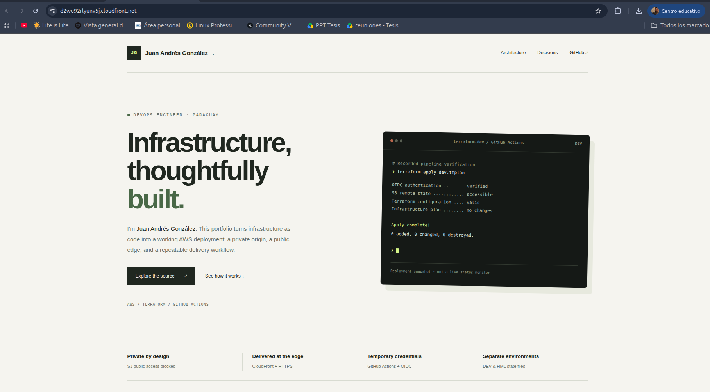
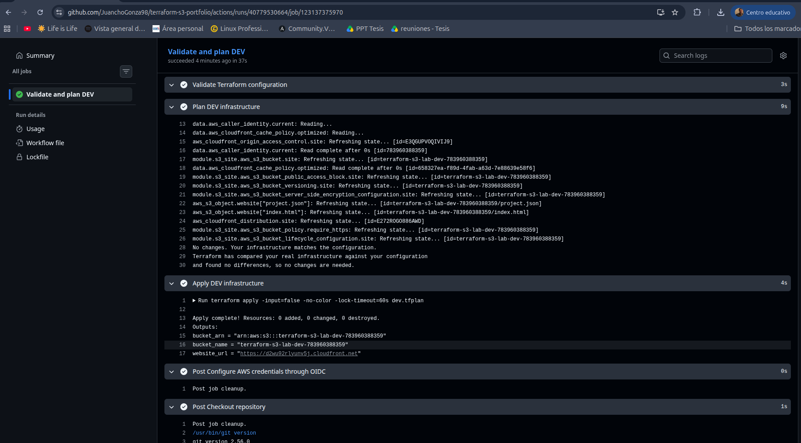
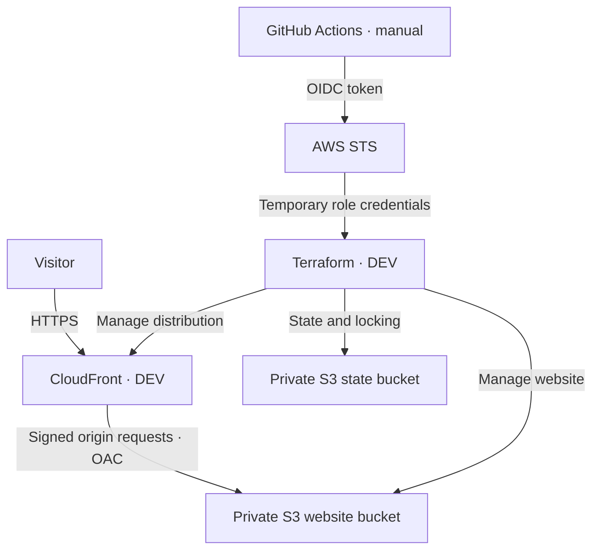

# Terraform S3 Portfolio

A hands-on AWS infrastructure project by **Juan Andrés González**, built to practice Terraform and demonstrate a small, reproducible delivery workflow.

The DEV website is served through Amazon CloudFront with a private Amazon S3 origin. GitHub Actions uses OIDC to obtain temporary AWS credentials, generate a Terraform plan, and optionally apply that saved plan.

[Website](https://d2wu92rlyunv5j.cloudfront.net) · [Workflow runs](https://github.com/JuanchoGonza98/terraform-s3-portfolio/actions) · [Security decisions](SECURITY.md)

> This is a learning portfolio, not a production reference architecture. The public deployment may be removed to control costs. No availability commitment is implied.

## Project Preview

### Website



### Delivery Workflow



## Architecture



- The website bucket blocks public access. CloudFront receives read access through a bucket policy restricted to the distribution ARN.
- The origin is the S3 regional REST endpoint, not the S3 website-hosting endpoint.
- CloudFront redirects viewer HTTP requests to HTTPS. The bucket policy denies insecure transport.
- Website objects use SSE-S3 encryption and versioning. Noncurrent versions expire after 7 days in DEV and 14 days in HML.
- DEV and HML use separate S3 backend keys and variable files within the same AWS account. These are separate environment deployments, not Terraform CLI workspaces.
- CloudFront and its OAC are deployed in DEV. HML was deployed as an S3-only environment before CloudFront was added to the shared root configuration.

## Scope and limitations

The project includes a reusable S3 module, website objects managed with `for_each`, environment-specific JSON rendered from a template, remote state, native S3 state locking, and a manual DEV workflow.

It intentionally excludes a custom domain, Route 53, WAF, customer-managed KMS keys, and access-log infrastructure. Accepted scanner findings and their implications are documented in [SECURITY.md](SECURITY.md).

Important operational boundaries:

- **The current root configuration contains CloudFront.** Planning it against HML may propose creating a HML distribution and OAC. Do not apply that expansion unless intentionally extending scope.
- Backend selection and variable selection are independent. Always pair `backends/dev.hcl` with `environments/dev.tfvars`, or the HML equivalents.
- The GitHub role maintains existing DEV resources. Its policy includes concrete resource identifiers and is not a general-purpose provisioning or teardown role.
- Bootstrap has an independent local state. Keep an access-controlled backup outside Git; the remote application states do not back up bootstrap automatically.
- The public page reports recorded verification evidence, not live monitoring.

## Repository layout

| Path | Responsibility |
| --- | --- |
| `bootstrap/` | State bucket, GitHub OIDC provider, and DEV deployment role |
| `modules/s3-site/` | Private S3 bucket, policy, encryption, versioning, and retention |
| `backend.tf`, `backends/` | S3 backend declaration and environment configuration |
| `environments/` | DEV and HML input values |
| `main.tf`, `locals.tf` | Module composition and website object deployment |
| `cloudfront.tf` | DEV CloudFront distribution, cache policy lookup, and OAC |
| `website/` | HTML and environment metadata template |
| `moved.tf` | Resource address migrations from earlier refactors |
| `.github/workflows/terraform-dev.yml` | Manual validation, plan, and optional apply |
| `.tflint.hcl` | Terraform lint configuration |
| `infracost.yml`, `infracost-usage.yml` | Cost scenario configuration |
| `SECURITY.md` | Controls, accepted findings, and verification boundaries |

## Tooling

The project was developed on Ubuntu 24.04 with:

| Tool | Version used |
| --- | --- |
| Terraform | 1.15.8 |
| AWS provider | 6.70.0, selected in the committed lock files |
| AWS CLI | 2.x |
| TFLint | 0.65.0 |
| Trivy | 0.76.1 |
| Infracost | 2.18.2 |

Terraform configurations require Terraform `>= 1.12.0, < 2.0.0`. The root AWS provider constraint is `~> 6.0`. The workflow explicitly installs Terraform 1.15.8.

Use an AWS identity with the permissions required for the operation. Authenticate locally before running Terraform; never commit AWS credentials. Verify the active account with:

```bash
aws sts get-caller-identity
```

## Working with the existing DEV deployment

```bash
git clone git@github.com:JuanchoGonza98/terraform-s3-portfolio.git
cd terraform-s3-portfolio

terraform init -reconfigure -backend-config=backends/dev.hcl -lockfile=readonly
terraform fmt -check -recursive
terraform validate
terraform plan -var-file=environments/dev.tfvars -out=dev.tfplan
```

Review the plan before applying:

```bash
terraform apply dev.tfplan
terraform output
```

This sequence requires access to the existing backend and resources. An unrelated AWS account cannot reuse the checked-in identifiers unchanged.

### Reproducing in another account

This repository is a concrete portfolio deployment, not a one-command multi-account installer. Before applying in a new account:

1. Review the Terraform input variables, provider region, naming, and backend configuration.
2. Adapt the bootstrap OIDC trust to your repository's actual subject and intended branch.
3. Separate initial backend creation from deployment-role permissions that reference existing CloudFront resources. Create the backend first with a local provisioning identity.
4. Configure an empty application backend, then provision the DEV site using that local identity.
5. Update deployment-role resource ARNs with the new distribution, OAC, buckets, and state keys. Review and apply the bootstrap changes.
6. Update the workflow role ARN and allowed account ID. Test plan-only execution before enabling apply.

If an account already has the GitHub OIDC provider, reconcile ownership or import the existing provider rather than trying to create a duplicate. Do not copy another deployment's state into your account.

### Selecting environments

An existing state is selected with `-reconfigure`; this does not migrate or copy it:

```bash
terraform init -reconfigure -backend-config=backends/hml.hcl
terraform output bucket_name
```

Return to DEV before normal website work:

```bash
terraform init -reconfigure -backend-config=backends/dev.hcl
terraform output bucket_name
terraform plan -var-file=environments/dev.tfvars
```

The original local states were migrated using `terraform init -migrate-state`. Migration is a distinct operation: keep backups and verify the selected source and destination before using it.

## GitHub Actions delivery

The workflow is **manual**; a push alone does not deploy.

1. Commit and push a change to `main`.
2. Open **Actions → Terraform DEV → Run workflow** and choose `main`.
3. Leave **Apply the DEV Terraform plan** unchecked for a plan-only run.
4. Check it to generate and apply a plan within the same run.

The apply checkbox authorizes that run to apply automatically after a successful plan. It is **not** a second approval pause after reviewing the generated plan. Review the change before triggering an apply run.

The workflow performs checkout, Terraform setup, formatting checks, OIDC authentication, identity verification, backend initialization, validation, planning, and optional apply. It serializes its own DEV runs using a concurrency group. Backend locking also coordinates Terraform operations that use the same state.

The plan remains within the runner; the workflow does not upload it as an artifact. Keep plan files out of Git because they can contain sensitive data.

### OIDC trust

The role validates the token audience and exact repository/branch subject. The subject used here includes immutable GitHub owner and repository IDs:

```text
repo:JuanchoGonza98@72740630/terraform-s3-portfolio@1436450217:ref:refs/heads/main
```

These IDs and the role ARN are identifiers, not credentials. Protect repository write access and review changes to workflows. A valid workflow can exercise the permissions assigned to its role.

### Refreshing CloudFront after content updates

Updating an S3 object does not immediately evict every cached copy. After a successful deployment, invalidate the changed paths if immediate visibility is required:

```bash
aws cloudfront create-invalidation \
  --distribution-id E272ROGO886AWD \
  --paths "/" "/index.html" \
  --query 'Invalidation.{Id:Id,Status:Status}' \
  --output table \
  --no-cli-pager
```

Wait for completion, then refresh the browser. The current workflow does not automate invalidation. Invalidation requests are subject to AWS pricing and allowances.

## Quality, security, and costs

Only formatting and Terraform validation are currently enforced by the workflow. TFLint, Trivy, and Infracost were run locally; they are not CI gates.

```bash
terraform fmt -check -recursive
terraform validate
tflint --recursive

trivy config \
  --skip-dirs .terraform \
  --skip-dirs states \
  --skip-dirs bootstrap \
  --skip-files '*.tfplan' \
  --skip-files '*.tfstate*' \
  --tf-vars environments/dev.tfvars \
  .

infracost scan .
infracost inspect --failing
infracost inspect --json
```

The Trivy command above scopes the scan to the application configuration and excludes the separate bootstrap root. Review bootstrap independently when changing its configuration. These commands require their tools and any required authentication to be installed locally.

The recorded DEV Infracost scenario was approximately **USD 0.0982/month**, based on:

- 0.1 GB of standard S3 storage;
- 100 monthly tier-1 and 1,000 tier-2 S3 requests;
- 10,000 monthly CloudFront HTTPS requests and 1 GB of US-region internet transfer.

This is an illustrative usage estimate, not a billing guarantee or live bill. It excludes HML and bootstrap, and actual usage, retained object versions, invalidations, pricing, and allowances can change the result. Re-run the estimate when the configuration or assumptions change. Terminal summaries may round small costs to `$0`; inspect the JSON for precision.

A USD 2 monthly AWS budget alert was configured separately in the console. It is not managed by this repository and does not enforce a spending cap. Credits do not make resources inherently free.

## Recorded verification

- CloudFront returned HTTP 200 for the website over HTTPS.
- Direct anonymous access to the S3 `index.html` returned HTTP 403.
- DEV planning reported no changes after deployment.
- GitHub Actions authenticated using OIDC and completed a no-change apply.
- A subsequent HTML update was deployed through the workflow and became visible after CloudFront invalidation.

These results describe the tested deployment, not continuous monitoring or an exhaustive security assessment.

## Cleanup and state safety

Infrastructure remains in AWS when the local computer shuts down. Teardown is a deliberate operation, not a required end-of-session step.

1. Stop workflow executions and verify the AWS account.
2. Back up DEV and HML states and the separate bootstrap local state to an access-controlled location outside Git.
3. Select the intended backend and verify `terraform output bucket_name` and `terraform state list`.
4. Generate a destroy plan with the matching variable file, review every resource, and apply only if the result matches the intended environment.

For DEV, using a local identity authorized for teardown:

```bash
terraform init -reconfigure -backend-config=backends/dev.hcl
terraform output bucket_name
terraform state list
terraform plan -destroy -var-file=environments/dev.tfvars -out=dev-destroy.tfplan
# Destructive: execute only after reviewing the saved destroy plan.
terraform apply dev-destroy.tfplan
```

Repeat the environment selection and review separately for HML if removing it. The GitHub maintenance role is not intended to destroy the stack.

Website buckets use versioning and `force_destroy = false`. Destroying current Terraform-managed objects can leave historical versions or delete markers, so bucket deletion may fail with `BucketNotEmpty`. Inspect and intentionally remove remaining versions and delete markers only after confirming the bucket and accepting permanent data loss. A lifecycle rule is not an immediate empty-bucket operation. Re-plan after resolving a partial teardown.

**Keep the backend bucket while either environment still depends on it.** Bootstrap protects it with `prevent_destroy`. Removing that protection requires an explicit code change and a separate review. Never empty or delete the state bucket as a shortcut to website cleanup. Keep bootstrap state and final state backups until cleanup has been verified.

## Terraform concepts practiced

Providers and dependency locks; variables and validation; locals and tags; data sources; modules and outputs; `for_each`; conditional expressions; functions and templates; `moved` blocks; saved plans; separate backends; state migration and locking; and identity-based CI/CD.

## Author

**Juan Andrés González** · DevOps Engineer · Paraguay

[GitHub](https://github.com/JuanchoGonza98)
